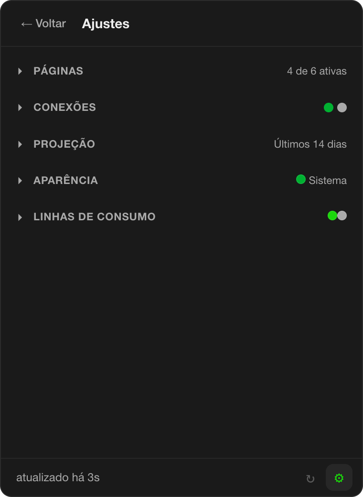

# ClawdMeter

ClawdMeter is a menu bar app for macOS, Windows and Linux that shows, in one click, how much of your Claude plan you have used and what is happening in your workday: consumption of the 5-hour and 7-day windows with a projection up to the reset, your open Claude Code sessions, your Pull Requests and the Reviews waiting for you. Everything runs on your computer, with no Mottu server in the middle.

> **Windows and Linux are experimental:** they are built by CI on every release but have barely been used on real machines. Please [report problems](https://github.com/rafalibano/clawdmeter/issues).


## Contents

1. [Download](#1-download)
2. [Install and open the app](#2-install-and-open-the-app): [macOS](#macos-14-or-later) · [Windows](#windows-1011-x64) · [Linux](#linux-x86_64)
3. [First setup inside the app](#3-first-setup-inside-the-app)
4. [Daily use](#4-daily-use)
5. [Updates](#5-updates)
6. [Privacy and security](#privacy-and-security) · [Uninstall](#uninstall) · [Common problems](#common-problems) · [For developers](#for-developers)

## What it shows

| Tab | What it shows |
|---|---|
| Usage | bars for the 5h and 7d consumption of the selected Claude account, with a mark at the projected % at the reset, optional blocks with the weekly limit per model, the extra usage and the resets left (each can be turned off in Settings > Usage tab), and a history chart (1h, 6h, 1d, 7d, 30d or the weekly cycle) |
| Sessions | the open Claude Code sessions and the ones waiting for you |
| Pull Requests | your open PRs, grouped by repository, with CI, review, conflict and age |
| Reviews | PRs for you to review and the ones you already reviewed |

The **Skills** (run Claude Code skills) and **Agenda** (Outlook/Teams meetings) tabs are under maintenance and come turned off.

## 1. Download

Open the [latest release](https://github.com/rafalibano/clawdmeter/releases/latest), scroll down to **Assets** and download the file for your computer (`<version>` is the release number, for example `0.2.1`):

| Your computer | File to download |
|---|---|
| Mac with an Apple chip (M1 or newer) or an Intel chip, macOS 14 or later | `ClawdMeter_<version>_universal.dmg` |
| Windows 10 or 11, 64-bit | `ClawdMeter_<version>_x64-setup.exe` (recommended) |
| Windows, if you prefer an MSI package | `ClawdMeter_<version>_x64_en-US.msi` |
| Linux x86_64, Ubuntu 22.04 or newer (updates itself) | `ClawdMeter_<version>_amd64.AppImage` |
| Debian, Ubuntu and derivatives, x86_64 (updated by hand) | `ClawdMeter_<version>_amd64.deb` |

Ignore the other files (`.sig`, `.tar.gz`, `latest.json`): they are for the automatic updater.

## 2. Install and open the app

### macOS (14 or later)

1. Double-click the downloaded `.dmg`. A window opens with the ClawdMeter icon and the **Applications** folder: drag **ClawdMeter** onto **Applications**, then eject the disk image.
2. The app is not signed by Apple (it has its own signature, which macOS does not trust), so macOS refuses to open it ("ClawdMeter cannot be opened" or "is damaged"). Open **Terminal** (Applications > Utilities) and run:

   ```bash
   xattr -dr com.apple.quarantine "/Applications/ClawdMeter.app"
   ```

3. Open **ClawdMeter** from the Applications folder (always from there, not from the disk image). Nothing opens in the Dock: the mascot icon shows up in the menu bar, at the top right of the screen.
4. Click the mascot icon. A panel opens under it with the tabs; until you add a Claude account (step 3), the Usage tab says there is no account yet.
5. When the app saves or reads a token for the first time (your Claude account, a GitHub token), macOS may ask "ClawdMeter wants to use your confidential information stored in … in your keychain". Type your Mac password and click **Always Allow** (or **Allow**). The app's signature stays the same between versions, so updates keep **Always Allow**. The one exception is updating from 0.2.2 or earlier, which asks once more per token because those versions had a signature that changed with every build.

> **Upgrading from 0.1.x:** the old versions read the Claude Code login from the Keychain. That reading was removed, so after the upgrade add your account once in **Settings > Claude accounts**. Your usage history is kept and moves to the first account you add.

### Windows 10/11, x64

1. Double-click the downloaded `.exe` (or `.msi`).
2. The installer is not signed with a Windows certificate, so SmartScreen shows a blue "Windows protected your PC" window with only a **Don't run** button. Click **More info**, check that the app is `ClawdMeter_…`, and click **Run anyway**. Then follow the installer.
3. Open **ClawdMeter** from the Start menu. No window and no taskbar button appear: the mascot icon shows up in the notification area, next to the clock. If you do not see it, click the **^** arrow (hidden icons) and drag the mascot onto the taskbar to keep it visible.
4. Left-click the mascot to open the panel. Right-click it for **Quit ClawdMeter**.

What is different on Windows:

- **Icon:** the tray icon shows only the mascot, which fills as the 7d consumption grows; the 5h and 7d percentages and reset times are in the tooltip (hover the icon).
- **Tokens** are kept in the Windows Credential Manager instead of the Keychain.
- **Notifications:** there is no permission prompt. The app reads whether notifications are allowed for ClawdMeter in Windows Settings > System > Notifications; if they are blocked, the Notifications row shows **Open system settings**, which opens that page.
- **Shortcut:** **Ctrl + Alt + D**. If it does nothing, another app may already use it (or AltGr on your keyboard layout sends Ctrl + Alt); the failure is written to the log.

### Linux x86_64

Needs a distribution at least as recent as Ubuntu 22.04 (glibc 2.35). Before installing, check the three things the app needs from your desktop:

- **A tray that shows app icons (AppIndicator / StatusNotifierItem).** KDE Plasma, Cinnamon, XFCE, MATE, Budgie and Ubuntu's GNOME have one. Plain GNOME (Fedora, Debian, Arch) does not: install the **AppIndicator and KStatusNotifierItem Support** extension (`gnome-shell-extension-appindicator`), then log out and in.
- **A Secret Service for the tokens:** GNOME Keyring (`gnome-keyring`) or KWallet with its Secret Service API turned on. Without one, adding a Claude account or a GitHub token fails with "No Secret Service is running" and **nothing is saved**: the app never writes tokens to a plain file.
- **A notification server** for the usage alerts (every desktop above has one).

**AppImage** (recommended, updates itself):

1. Install FUSE 2, which AppImages need to start: `sudo apt install libfuse2` on Ubuntu 22.04, `sudo apt install libfuse2t64` on Ubuntu 24.04 or later, `sudo dnf install fuse-libs` on Fedora.
2. Move the file to a folder of your own (for example `~/Applications`) and make it executable:

   ```bash
   mkdir -p ~/Applications
   mv ~/Downloads/ClawdMeter_<version>_amd64.AppImage ~/Applications/
   chmod +x ~/Applications/ClawdMeter_<version>_amd64.AppImage
   ```

3. Run it (double-click it in the file manager or run the path in a terminal). Keep it in that folder: launch at login and the updater point at that file.

**.deb** (Debian, Ubuntu and derivatives; does **not** update itself):

1. Install it with apt, which also installs the runtime libraries (`libwebkit2gtk-4.1-0`, `libgtk-3-0`, `libayatana-appindicator3-1`):

   ```bash
   sudo apt install ./ClawdMeter_<version>_amd64.deb
   ```

2. Open **ClawdMeter** from the app menu.

Then:

1. The mascot icon shows up in the tray (top bar or panel). No window opens.
2. Click the icon: a menu opens with **Open panel** and **Quit ClawdMeter**. Linux trays only report menu choices, not clicks on the icon, so the panel always opens from **Open panel** (or the shortcut). The panel opens at the top right of the screen with the mouse pointer; click outside it to close it.
3. The first time a token is saved, GNOME Keyring or KWallet may ask for your login password to unlock the keyring. If you dismiss that prompt, the app says it could not access the keychain and saves nothing.

What is different on Linux:

- **Icon:** like Windows, only the mascot filling with the 7d consumption. Most Linux trays do not show tooltips, so open the panel to see the numbers.
- **Tokens** are kept in the Secret Service (GNOME Keyring or KWallet), under the `com.mottu.clawdmeter` service.
- **Notifications:** there is no permission prompt; the Notifications row shows **Connected** when the desktop has a notification server. Turn ClawdMeter's notifications on or off in your desktop's settings (**Open system settings** opens GNOME Settings or KDE System Settings when the row shows a problem).
- **Shortcut:** **Ctrl + Alt + D** works on X11. On Wayland most compositors do not let apps register global shortcuts, so it usually does nothing (the failure is written to the log); use **Open panel**. On Wayland the compositor may also place the panel itself instead of at the top right.
- **Launch at login** writes `~/.config/autostart/ClawdMeter.desktop`. For the AppImage it points at the `.AppImage` file, so turn it off and on again if you move that file.
- **Updates:** the AppImage updates itself like the other systems (the file is replaced in place, so it must be writable). The `.deb` is never offered the update: install the new `.deb` with `sudo apt install ./ClawdMeter_<version>_amd64.deb`.
- **Opening a terminal** (GitHub CLI sign-in, Skills) uses the first of `x-terminal-emulator`, `gnome-terminal` or `konsole` it finds.

## 3. First setup inside the app

Open the panel and click the gear (⚙) in the bottom right corner: **Settings** opens, with collapsible sections. Do these steps in order.



1. **Add your Claude account** (required for the Usage tab). Open **Claude accounts**, type a name in **Account name** (for example "Work") and click **Add account**. The app shows "Opening the browser…" and then "Waiting for the browser to sign in to Work…", and the browser opens the Claude sign-in page. Sign in and authorize; the browser comes back to a local page, the app shows "Work added." and the Usage tab starts filling in.
   - If the browser does not come back to the app, click **Paste code**: a Claude page opens with a code. Copy it, paste it in **Code shown in the browser** and click **Confirm**.
   - You can add up to 5 accounts, each with its own history and alerts. With two or more, the Usage tab shows the initials of the active account to the right of the tabs; click them to switch. The same section has **Rename**, **Remove** and **Sign in again**.
   - Claude usage does not depend on Claude Code: ClawdMeter signs in by itself. Claude Code is only needed for the Sessions tab and for Skills.
2. **Connect GitHub** (required for Pull Requests, Reviews and automatic updates). Open **Connections**; the GitHub row shows **Disconnected** and offers three ways to connect:
   - **GitHub CLI:** if `gh` is installed and signed in (`gh auth login`), the app uses it. Without it, the row offers **Install GitHub CLI** or **Connect GitHub CLI**; finish in the Terminal and click **Check again**.
   - **Sign in with the browser:** the app shows a code with a **Copy** button and opens a GitHub page. Paste the code there and click **Authorize**; the app shows "Waiting for authorization…" until it is done (**Cancel** stops it).
   - **Paste token:** click **Create token on GitHub**, create a token with the `repo` and `read:org` scopes, paste it and click **Save**.

   When it works, the row shows **Connected**. The connection also checks access to the `Mottu-ops` organization; outside it, the row shows a warning, but automatic updates only need the token.
3. **Allow notifications** (required for usage alerts). In **Connections**, the **Notifications** row shows **Connect** while macOS was never asked. Click it and click **Allow** in the macOS prompt; the row turns **Connected**. If you skip this, the first alert that is due asks by itself. If you denied it before, the row shows **Open system settings**: turn on notifications for ClawdMeter there and click **Check again**. (On Windows, see the differences above.)
4. **Choose the usage alerts.** In **Usage alerts**, tick the percentages (25%, 50%, 75%, 100%) for the 5h and 7d windows; 50% on both is the default and a window with nothing ticked is off. Each percentage notifies once per cycle.
5. **Launch at login** (optional, off by default). In **System**, turn on **Launch at login**. On macOS it only turns on when the app runs from the Applications folder (not from the disk image); otherwise the switch goes back off with an error. On Windows it writes only the `ClawdMeter` value under the current user's `Run` key, so it never needs administrator rights, and turning the app off in Task Manager > Startup apps is respected.
6. **Language and look.** The app opens in English; in **Appearance** pick Português (Brasil) or Español (México), plus the accent color, background and light/dark/system theme. **Pages** turns tabs on and off, and **Projection** chooses how the reset projection is computed. Changes apply right away.

## 4. Daily use

- **Open the panel:** click the mascot icon (on Linux, click it and choose **Open panel**), or press **Ctrl + Option + D** on macOS (**Ctrl + Alt + D** on Windows and on Linux with X11), which also works when the icon is hidden. Click outside the panel to close it.
- **Read the icon without opening it:** on macOS the mascot fills as the weekly (7d) consumption grows and shows the 5h and 7d bars; on Windows the numbers are in the tooltip; on Linux only the mascot fills.
- **Tabs** (details in [What it shows](#what-it-shows)): Usage has the 5h and 7d bars with the projected % at the reset and a history chart; Sessions lists your open Claude Code sessions; Pull Requests and Reviews list your PRs and the ones waiting for your review (click one to open it on GitHub).
- **Quit:** right-click the icon and choose **Quit ClawdMeter**.

## 5. Updates

ClawdMeter updates itself from the [Releases](https://github.com/rafalibano/clawdmeter/releases) of its GitHub repository. The repository is public, so any GitHub account can read the releases, but the app still asks GitHub with your connected account: you need **GitHub connected** (step 3.2). Without it, Settings > Updates shows "Connect GitHub to receive updates" and the app does not check.

1. The app checks when it opens and every 6 hours. When there is a new version, a "New version X · Update" bar appears at the top of the panel.
2. Click **Update**. The bar shows "Downloading X… N%". Every update is signed, and the app refuses a file whose signature does not match.
3. On macOS the bar then asks "Version X installed. Restart now?": click **Restart** (or **Later**, and restart when you want). On Windows the installer runs in passive mode and closes the app. On Linux the AppImage file is replaced and the bar asks to restart like on macOS; the `.deb` is not updated by the app (see [Linux](#linux-x86_64)).

To check right away, open **Settings > Updates**: it shows the current version, the last check and a **Check now** button. If Settings > Updates shows version 0.1.1 (the build published as 0.2.0 reports that number), the app offers the update on its next check.

To update by hand (no GitHub connected, or an update that fails), download the new file from the [latest release](https://github.com/rafalibano/clawdmeter/releases/latest) and install it over the old one as in step 2; settings, accounts and history are kept. On macOS, run the `xattr` command again after replacing the app.

## Privacy and security

Everything stays on your computer. There is no ClawdMeter server, nothing is sent to Mottu and there is no telemetry.

What the app reads:

- **Your Claude accounts' sign-in**, done by ClawdMeter itself in the browser. The tokens are kept in the macOS Keychain (on Windows, the Credential Manager; on Linux, the Secret Service), renewed by the app's native layer and never leave it.
- **`~/.claude/sessions`**, to list your open Claude Code sessions.
- **The usage history**, one file per Claude account, which the app itself keeps in `~/Library/Application Support/com.mottu.clawdmeter` (on Windows, `%APPDATA%\com.mottu.clawdmeter`; on Linux, `~/.config/com.mottu.clawdmeter` and `~/.local/share/com.mottu.clawdmeter`), along with your settings.

Who the app talks to over the internet, and only these:

- `claude.ai`, `platform.claude.com` and `api.anthropic.com`: the sign-in of your Claude accounts and their consumption.
- `api.github.com`: your PRs and Reviews, and the app updates (the download itself comes from GitHub's file storage, `release-assets.githubusercontent.com`).
- `graph.microsoft.com`: the agenda (tab under maintenance).

The GitHub token, if you use one, is kept in the Keychain (on Windows, the Credential Manager; on Linux, the Secret Service). ClawdMeter signs in to Claude with the same public client used by ClaudeUsageBar (editable in Settings); Anthropic's terms do not foresee third-party apps doing this, so use it at your own risk (see [docs/SECURITY.md](docs/SECURITY.md)). Skills, when they come back, will only be able to run a closed list of read commands.

Technical details: [docs/SECURITY.md](docs/SECURITY.md).

## Uninstall

### macOS

1. If you turned on **Settings > System > Launch at login**, turn it off before deleting the app. If the app is already gone, delete the login entry by hand:

   ```bash
   rm -f "$HOME/Library/LaunchAgents/ClawdMeter.plist"
   ```

2. Quit the app (right-click the menu bar icon > Quit ClawdMeter) and delete **ClawdMeter** from the Applications folder.
3. Delete the app folders:

   ```bash
   rm -rf "$HOME/Library/Application Support/com.mottu.clawdmeter" \
          "$HOME/Library/Logs/com.mottu.clawdmeter" \
          "$HOME/Library/Caches/com.mottu.clawdmeter"
   ```

4. Open the **Keychain Access** app, search for `com.mottu.clawdmeter` and delete the items found (they include the Claude accounts' tokens; removing an account in Settings deletes its tokens too).

### Windows

Where the app keeps its files:

| What | Where |
|---|---|
| Settings and usage history | `%APPDATA%\com.mottu.clawdmeter` |
| Log (`popover.log`) | `%LOCALAPPDATA%\com.mottu.clawdmeter\logs` |
| Cache | `%LOCALAPPDATA%\com.mottu.clawdmeter` |
| Claude account and GitHub tokens | Windows Credential Manager (Windows Credentials), entries with `com.mottu.clawdmeter` |
| Claude Code sessions read by the app | `%USERPROFILE%\.claude\sessions` |

1. Turn off **Settings > System > Launch at login**. If the app is already gone, delete the `ClawdMeter` value under `HKEY_CURRENT_USER\Software\Microsoft\Windows\CurrentVersion\Run` (Registry Editor, or `reg delete "HKCU\Software\Microsoft\Windows\CurrentVersion\Run" /v ClawdMeter /f`).
2. Quit the app (right-click the icon > Quit ClawdMeter) and uninstall **ClawdMeter** in Windows Settings > Apps > Installed apps.
3. Delete the `%APPDATA%\com.mottu.clawdmeter` and `%LOCALAPPDATA%\com.mottu.clawdmeter` folders.
4. Open **Credential Manager** > **Windows Credentials** and remove the entries with `com.mottu.clawdmeter`.

### Linux

Where the app keeps its files:

| What | Where |
|---|---|
| Settings | `~/.config/com.mottu.clawdmeter` |
| Usage history and app data | `~/.local/share/com.mottu.clawdmeter` |
| Log (`popover.log`) | `~/.local/share/com.mottu.clawdmeter/logs` |
| Cache | `~/.cache/com.mottu.clawdmeter` |
| Claude account and GitHub tokens | Secret Service (GNOME Keyring or KWallet), service `com.mottu.clawdmeter` |
| Launch at login entry | `~/.config/autostart/ClawdMeter.desktop` |

1. Turn off **Settings > System > Launch at login**, or delete the entry by hand: `rm -f ~/.config/autostart/ClawdMeter.desktop`.
2. Quit the app (click the tray icon > **Quit ClawdMeter**). Delete the `.AppImage` file, or remove the package with `sudo apt remove clawd-meter` (the package name Tauri derives from `ClawdMeter`).
3. Delete the app folders:

   ```bash
   rm -rf ~/.config/com.mottu.clawdmeter ~/.local/share/com.mottu.clawdmeter ~/.cache/com.mottu.clawdmeter
   ```

4. Delete the tokens: in **Passwords and Keys** (Seahorse) or **KWalletManager**, search for `com.mottu.clawdmeter` and delete the items, or run `secret-tool clear service com.mottu.clawdmeter` once per item.

## Common problems

- **"Anthropic rate limit" (error 429):** Anthropic limits how often usage can be queried. The app waits on its own and tries again, showing the latest data in the meantime. You do not need to do anything.
- **The panel opens blank or does not show up over a large or full-screen window:** fixed in 0.2.1; update if you are on an older version. If it happens again, send the `~/Library/Logs/com.mottu.clawdmeter/popover.log` file (Windows: `%LOCALAPPDATA%\com.mottu.clawdmeter\logs\popover.log`) to whoever maintains the app.
- **Usage alerts never arrive:** check the Notifications row in **Settings > Connections**. **Connect** means macOS was never asked (click it and allow); **Open system settings** means notifications are blocked for ClawdMeter.
- **The icon disappeared from the menu bar:** on Macs with a notch, macOS may hide icons when the bar is full. Use the **Ctrl + Option + D** shortcut to open the panel. On Windows, look in the hidden icons (**^**) of the notification area.
- **Linux: no icon in the tray:** the desktop has no AppIndicator support. On GNOME install the AppIndicator extension (see [Linux](#linux-x86_64)); meanwhile **Ctrl + Alt + D** opens the panel on X11.
- **Linux: "No Secret Service is running":** install and start GNOME Keyring (`sudo apt install gnome-keyring`, then log out and in) or turn on the Secret Service in KWallet, and try again. Nothing was saved in the meantime.
- **"Sign in again" on a Claude account:** the app could not renew that account's sign-in. Click **Sign in again** (on the Usage tab or in Settings > Claude accounts) and sign in in the browser.
- **"No Claude account yet":** add an account in **Settings > Claude accounts**.

## For developers

Prerequisites, commands, folder structure and how to contribute: [docs/DEVELOPMENT.md](docs/DEVELOPMENT.md). Architecture: [docs/ARCHITECTURE.md](docs/ARCHITECTURE.md). Version history: [CHANGELOG.md](CHANGELOG.md).

## License and credits

Mottu internal use. The repository has no public license and must not be distributed outside the company.

- The usage chart behavior is based on ClaudeUsageBar (BSD-2-Clause license).
- The mascot belongs to Anthropic and is used internally only.
- Built with Tauri 2, Angular 21 and Apache ECharts; the remaining dependencies are listed in `package.json` and `src-tauri/Cargo.toml`.
