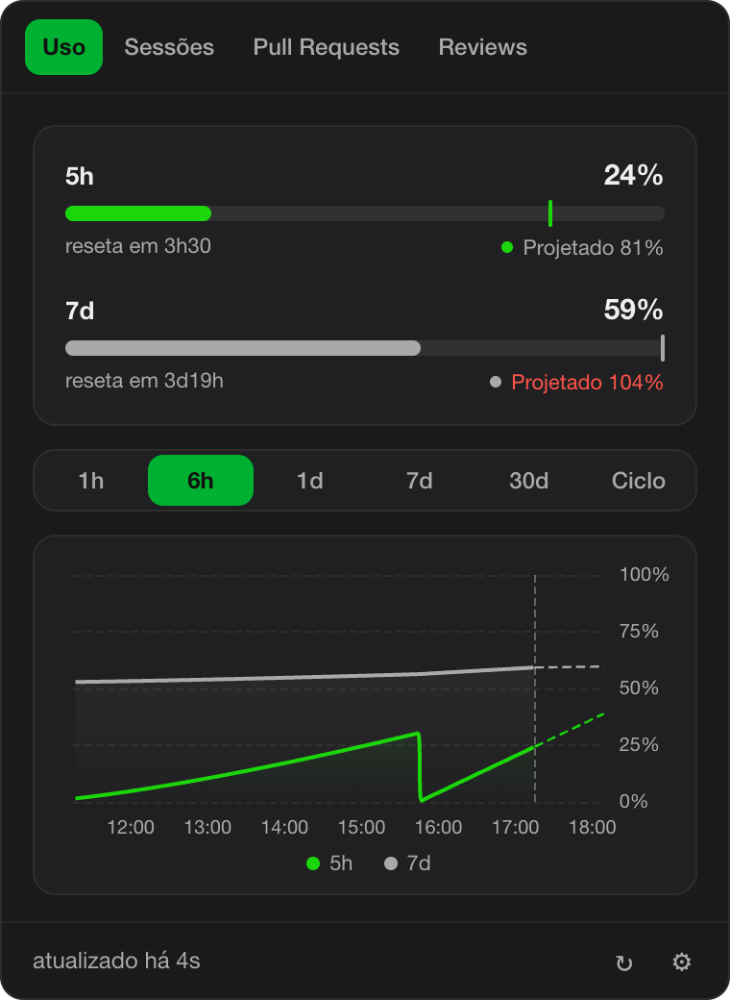

# ClawdMeter

O ClawdMeter é um app de barra de menu para macOS que mostra, num clique, quanto você já usou do Claude Code e o que está acontecendo no seu dia de trabalho: o consumo das janelas de 5 horas e de 7 dias com projeção até o reset, as sessões abertas do Claude Code, seus Pull Requests e os Reviews que esperam por você. Tudo roda no seu computador, sem servidor da Mottu no meio.



## O que ele mostra

| Aba | O que mostra |
|---|---|
| Uso | barras do consumo de 5h e 7d, com uma marca no % projetado até o reset, e um gráfico do histórico (1h, 6h, 1d, 7d, 30d ou o ciclo semanal) |
| Sessões | as sessões abertas do Claude Code e as que estão esperando você |
| Pull Requests | seus PRs abertos, agrupados por repositório, com CI, review, conflito e idade |
| Reviews | PRs para você revisar e os que você já revisou |

As abas **Skills** (rodar skills do Claude Code) e **Agenda** (reuniões do Outlook/Teams) estão em manutenção e vêm desligadas.

## Instalação (macOS 14 ou superior)

1. Abra o arquivo `ClawdMeter_0.1.0_aarch64.dmg` e arraste o **ClawdMeter** para a pasta **Aplicativos**.
2. O app ainda não é assinado pela Apple, então o macOS bloqueia a primeira abertura. Abra o **Terminal** e rode:

   ```bash
   xattr -dr com.apple.quarantine "/Applications/ClawdMeter.app"
   ```

3. Abra o ClawdMeter pela pasta Aplicativos. O ícone do mascote aparece na barra de menu (o app não aparece no Dock).
4. Na primeira abertura o macOS pergunta se o ClawdMeter pode usar o Keychain para ler a credencial do Claude Code. Clique em **Permitir**.

O `.dmg` é para Macs com chip Apple (M1 ou mais novo). Você precisa ter o Claude Code instalado e com login feito.

## Primeiros passos

- Clique no ícone do mascote na barra de menu para abrir o painel. Se o ícone estiver escondido, use o atalho **Ctrl + Option + D**.
- Clique na engrenagem (⚙) no canto inferior direito para abrir os **Ajustes**: abas ligadas, conexões, método de projeção, idioma, cores e tema claro/escuro.
- Para ver Pull Requests e Reviews, conecte o GitHub em **Ajustes > Conexões**. Há três jeitos: usar o `gh` CLI que já está logado no seu Mac, entrar pelo navegador ou colar um token de acesso.
- Para sair do app, clique com o botão direito no ícone da barra de menu.


## Privacidade e segurança

Tudo fica no seu computador. Não existe servidor do ClawdMeter, nada é enviado para a Mottu e não há telemetria.

O que o app lê:

- **A credencial do Claude Code**, só para leitura, no Keychain do macOS. O app nunca a renova, nunca a grava em outro lugar e ela não sai da camada nativa do app.
- **`~/.claude/sessions`**, para listar suas sessões abertas do Claude Code.
- **O histórico de uso**, que o próprio app guarda em `~/Library/Application Support/com.mottu.clawdmeter`, junto com seus ajustes.

Com quem o app conversa pela internet, e só com estes:

- `api.anthropic.com`: seu consumo do Claude.
- `api.github.com`: seus PRs e Reviews.
- `graph.microsoft.com`: a agenda (aba em manutenção).

O token do GitHub, se você usar um, fica no Keychain. As skills, quando voltarem, só poderão rodar uma lista fechada de comandos de leitura.

Detalhes técnicos: [docs/SECURITY.md](docs/SECURITY.md).

## Desinstalar

1. Feche o app (botão direito no ícone da barra de menu > Sair) e apague **ClawdMeter** da pasta Aplicativos.
2. Apague as pastas do app:

   ```bash
   rm -rf "$HOME/Library/Application Support/com.mottu.clawdmeter" \
          "$HOME/Library/Logs/com.mottu.clawdmeter" \
          "$HOME/Library/Caches/com.mottu.clawdmeter"
   ```

3. Abra o app **Acesso às Chaves** (Keychain Access), busque por `com.mottu.clawdmeter` e apague os itens encontrados. A credencial do Claude Code não é do ClawdMeter e deve ficar.

## Problemas comuns

- **"Limite de consultas da Anthropic" (erro 429):** a Anthropic limita a frequência da consulta de uso. O app espera sozinho e tenta de novo, mostrando os últimos dados enquanto isso. Não precisa fazer nada.
- **O painel não aparece com outro app em tela cheia:** é uma limitação conhecida do macOS. Se acontecer, mande o arquivo `~/Library/Logs/com.mottu.clawdmeter/popover.log` para quem mantém o app.
- **O ícone sumiu da barra de menu:** em Macs com notch, o macOS pode esconder ícones quando a barra está cheia. Use o atalho **Ctrl + Option + D** para abrir o painel.
- **"Refazer login do Claude":** o login do Claude Code venceu. Rode `claude /login` no Terminal (ou use o botão do próprio app).

## Windows

Existe uma versão para Windows no código, mas ela ainda não foi validada em um computador Windows. Por enquanto o suporte oficial é só macOS.

## Para quem desenvolve

Pré-requisitos, comandos, estrutura de pastas e como contribuir: [docs/DEVELOPMENT.md](docs/DEVELOPMENT.md). Arquitetura: [docs/ARCHITECTURE.md](docs/ARCHITECTURE.md). Histórico de versões: [CHANGELOG.md](CHANGELOG.md).

## Licença e créditos

Uso interno Mottu. O repositório não tem licença pública e não deve ser distribuído fora da empresa.

- O comportamento do gráfico de uso tem como referência o ClaudeUsageBar (licença BSD-2-Clause).
- O mascote é da Anthropic e é usado apenas internamente.
- Construído com Tauri 2, Angular 19 e Apache ECharts; as demais dependências estão em `package.json` e `src-tauri/Cargo.toml`.
